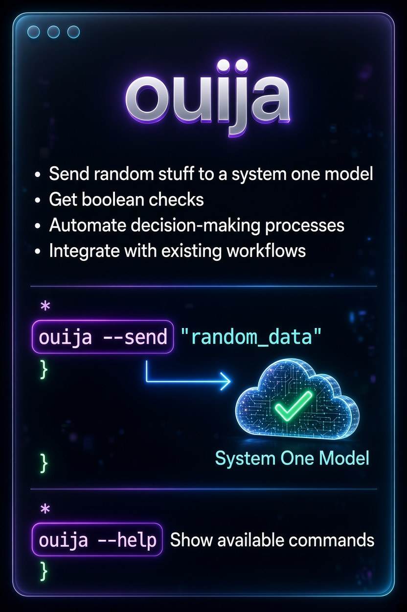

<p align="center"></p>

<p align="center"><em>(artist's impression; the spirits don't actually take <code>--send</code>)</em></p>

# ouija

Ask the spirits a yes/no question from your shell. They answer in one breath, with probabilities, and without making anything up.

```console
$ tail -n 40 app.log | ouija noul "Is anything broken?"
true
P(true)=0.991  conf 0.98  (312 ms)
🕯️ the candles burn steady: yes

$ echo $?
0
```

The answer goes to **stdout**, the evidence goes to **stderr**, and the verdict is the **exit code**. That makes it a shell primitive: put it in an `if`, a `case`, a git hook or a cron job.

## What it is

`ouija` is a small client for **System One decision models**. These models do not write text. One forward pass reads your input and returns a typed answer with probabilities: a yes/no (`noul`), one pick from a set of options (`choice`), or a rating on an ordered scale (`score`). A request takes about 300-400 ms for typical inputs, and there is no sampling, no prompt format to coax, and no output to parse.

`ouija` works with any server that speaks the karpo-decision `/v1/systemone` API. The reference server is [github.com/machinepulse-ai/karpo-decision](https://github.com/machinepulse-ai/karpo-decision), serving the model [MachinePulseAI/karpo-decision-31B](https://huggingface.co/MachinePulseAI/karpo-decision-31B). Run it on a GPU box somewhere, point `ouija` at it, and every machine you own can ask it questions.

## Install

### Release binary

Static Linux (x86_64, aarch64) and macOS (Apple silicon) builds are attached to each [GitHub release](https://github.com/rbalch/ouija/releases):

```bash
curl -LO https://github.com/rbalch/ouija/releases/download/v0.1.0/ouija-0.1.0-x86_64-unknown-linux-musl.tar.gz
curl -LO https://github.com/rbalch/ouija/releases/download/v0.1.0/ouija-0.1.0-x86_64-unknown-linux-musl.tar.gz.sha256
sha256sum -c ouija-0.1.0-x86_64-unknown-linux-musl.tar.gz.sha256
tar xzf ouija-0.1.0-x86_64-unknown-linux-musl.tar.gz
install -m755 ouija-0.1.0-x86_64-unknown-linux-musl/ouija ~/.local/bin/
```

On macOS use `shasum -a 256 -c` instead of `sha256sum -c`.

### From source

```bash
cargo install --locked --git https://github.com/rbalch/ouija
```

### Nix

```bash
nix run github:rbalch/ouija -- config
nix profile install github:rbalch/ouija
```

With Home Manager, add the flake as an input and import the module:

```nix
{
  inputs.ouija.url = "github:rbalch/ouija";

  # in your Home Manager configuration:
  imports = [ inputs.ouija.homeManagerModules.default ];

  programs.ouija = {
    enable = true;
    settings = {
      url = "http://spark:18440";
      min_conf = 0.85;
      timeout = 30;
      flavor = true;
    };
  };
}
```

This installs the package and writes `~/.config/ouija/config.toml`. Unset keys are left out of the file. There is also `overlays.default` (adds `pkgs.ouija`) and a `devShells.default` for hacking on it.

## Configuration

`ouija` needs to know where the server is. The default is `http://localhost:18440`.

Settings come from four places. The first one that sets a value wins:

1. command-line flag (`--url`, `--min-conf`, `--timeout`, `--plain`)
2. environment (`OUIJA_URL`; `KARPO_URL` is accepted as a legacy alias; empty values are ignored)
3. config file
4. built-in default

The config file is `$OUIJA_CONFIG` if set, otherwise `$XDG_CONFIG_HOME/ouija/config.toml`, otherwise `~/.config/ouija/config.toml` (also on macOS). A missing file is fine. A malformed file, an unknown key or an out-of-range value is an error (exit 3) that names the file.

```toml
# ~/.config/ouija/config.toml
url      = "http://spark:18440"  # a bare host:port also works
min_conf = 0.8                   # 0..=1; below this an answer is "uncertain" (exit 2)
timeout  = 60                    # seconds, at least 1
flavor   = true                  # the stderr flavor line (see below)
```

Not sure what is in effect? Ask:

```console
$ ouija config
url       http://spark:18440   (config: /home/x/.config/ouija/config.toml)
min_conf  0.8                  (default)
timeout   60                   (default)
flavor    true                 (default)

config file: /home/x/.config/ouija/config.toml (found)

$ ouija config --check
...
server: ok (karpo-decision-31b)
```

`ouija config` never contacts the server. With `--check` it also calls `/healthz` and exits 3 if the server is unreachable, which is handy when setting up a fleet of machines.

## Usage

State (the thing being judged) comes from stdin, or from `--state "text"`, or `--state-file PATH`. If it parses as a JSON object it is sent as an object, otherwise as a string.

### noul: yes or no

Prints `true` or `false`.

```console
$ echo "disk full, service down" | ouija noul "Is anything broken?"
true
P(true)=1.000  conf 1.00  (298 ms)
```

### choice: pick one

Two or more options, each `key` or `key=description`. Prints the chosen key.

```console
$ git diff --staged | ouija choice "Commit type?" feat fix "refactor=Restructure without behavior change" chore
fix
fix 0.97 | refactor 0.02 | chore 0.01 | feat 0.00  (317 ms)
```

### score: rate it

Two or more levels, lowest to highest. Prints the most likely level; the detail line shows the expected value `E`.

```console
$ echo "Prod db is down for all users" | ouija score -v "Severity?" cosmetic minor major critical
critical
(315 ms)
  critical  ████████████████████ 0.99
  major                          0.01
  minor                          0.00
  cosmetic                       0.00
```

### run: many questions, one pass

`run SPEC` takes a JSON file that is the `questions` object itself (see [`examples/triage.json`](examples/triage.json)) and prints one `key=answer` line per question.

```console
$ ouija run examples/triage.json -q < email.txt
bucket=bills
page_now=false
urgency=today
```

Keys must be lowercase shell identifiers and are checked before anything is sent; a bad key exits 3 and names the offender. Values with anything outside `[A-Za-z0-9_.-]` are single-quoted, so a value can never inject shell syntax. Keys are restricted to lowercase names (`[a-z][a-z0-9_]*`) and checked against known shell specials (`path`, `status`, `home`, `ifs`, `ld_*`, `lc_*`, ...), which keeps them clear of special variables in bash and zsh. The spec is your own file, so `eval "$(ouija run ...)"` is as trustworthy as the spec you wrote.

Options or levels that begin with `-` need `--` in front of them, or the parser takes them for flags: `ouija score "Rating?" -- -1 0 1`.

### Options

| Flag | Meaning |
|------|---------|
| `--url URL` | Server base URL (env `OUIJA_URL`) |
| `--min-conf N` | Confidence below this is uncertain; default 0.8 |
| `--timeout S` | Request timeout in seconds, at least 1; default 60 |
| `--json` | Print the raw server response to stdout instead of the answer |
| `-v`, `--verbose` | Per-option bar chart on stderr instead of the one-line detail |
| `-q`, `--quiet` | No stderr output |
| `--plain` | No flavor line |
| `--state`, `--state-file` | Supply the state without stdin |

Standard proxy environment variables (`ALL_PROXY`, `HTTPS_PROXY`, `HTTP_PROXY`, in upper or lower case, plus `NO_PROXY`) are honored. For a server on your LAN, add it to `NO_PROXY` if you have a proxy set globally.

Stderr uses color only when it is a terminal and `NO_COLOR` is unset. The time shown is the server's model time from `Server-Timing`, or wall clock if that header is absent. Confidence is `|P - 0.5| * 2` for `noul`, and the server's `confidence` field for `choice` and `score`.

## Exit codes

| Code | Meaning |
|------|---------|
| 0 | `noul` true, or a confident `choice` / `score`. For `run`: every answer confident |
| 1 | `noul` false (confident) |
| 2 | Uncertain: confidence below `--min-conf`. For `run`: at least one answer uncertain |
| 3 | Error: server down, HTTP error, bad config or arguments, input too long (over 32768 tokens), or a failure writing stdout (closed pipe, full disk) |

`run` never exits 1. clap's usage errors, which normally exit 2, are mapped to 3, and a panic also exits 3, so 2 always means "the model was unsure".

## Shell gating

```bash
# Branch on a yes/no answer; treat "uncertain" separately.
ouija noul "Is anything broken?" < log.txt
case $? in
  0) echo "broken: paging" ;;
  1) echo "all good" ;;
  2) echo "not sure: send to a human" ;;
  *) echo "ouija failed" >&2 ;;
esac

# Pull several answers in one pass.
eval "$(ouija run examples/triage.json -q < email.txt)"
echo "$bucket / $urgency / page=$page_now"
```

A git pre-commit hook that blocks commits that look like they contain a secret. It also blocks when the model is unsure or ouija itself fails, so it fails closed:

```bash
#!/bin/sh
# .git/hooks/pre-commit
git diff --cached | head -c 60000 \
  | ouija noul -q "Does this diff add a password, API key or private key?"
case $? in
  0) echo "possible secret in staged changes" >&2; exit 1 ;;
  1) ;;  # confident no: allow the commit
  2) echo "ouija is unsure; review the diff by hand" >&2; exit 1 ;;
  *) echo "ouija failed" >&2; exit 1 ;;
esac
```

In a gate, decide deliberately what an error (exit 3) means. A security check should fail closed (block on 2 and 3, as above); a convenience nudge should fail open (treat 3 as "carry on"), so a server outage does not stop your work.

A log watcher that pages only when the model is confident:

```bash
tail -Fn0 app.log | while IFS= read -r line; do
  printf '%s\n' "$line" | ouija noul -q "Does this line indicate a failure needing a human?"
  [ $? -eq 0 ] && notify-send "app.log" "$line"
done
```

Requests are cheap but not free. Send them one at a time, and for busy logs batch a window of lines instead of one request per line.

## Latency

One request is one forward pass, so the cost follows the input length, not the number of questions:

| Input | Measured |
|---|---|
| ~300 tokens, 1-3 questions | ~300-400 ms |
| 40 lines of JSON docker logs | ~2.6 s |
| ~20 KB source diff | ~5.4 s |
| more than 32768 tokens | rejected by the server, exit 3 |

Ask several questions in one `run` rather than calling `ouija` repeatedly on the same input. Trim big inputs (`tail`, `head -c`) before piping them in.

## Confidence is not calibration

Confidence is a ranking signal, not a calibrated probability. On calibration probes the model was overconfident on chance events: a fair coin came back heads with P=0.89, and a 3-of-4 urn came back 1.00. It ranks answers well, but a 0.99 does not mean "right 99% of the time". Treat `--min-conf` as a threshold to tune on your own labelled examples, use it to route doubtful cases to a human, and do not read the numbers as odds.

## Flavor

In the default human mode, when stderr is a terminal, `ouija` adds one extra line after the detail:

```console
$ echo "maybe?" | ouija noul "Is anything broken?"
false
P(true)=0.293  conf 0.41  (296 ms)  ⚠ uncertain (< 0.80)
🕯️ the candles flicker… (uncertain)
```

The line is chosen from the outcome (yes, no, a picked answer, or uncertain) and varied by the response id. It is never printed when stderr is piped or redirected, with `-q` or `--json`, or when it is switched off, and it never changes stdout or the exit code. Turn it off with `--plain` or `flavor = false` in the config file. `NO_COLOR` only affects color; it does not hide the line.

## License

Apache-2.0. See [LICENSE](LICENSE).
